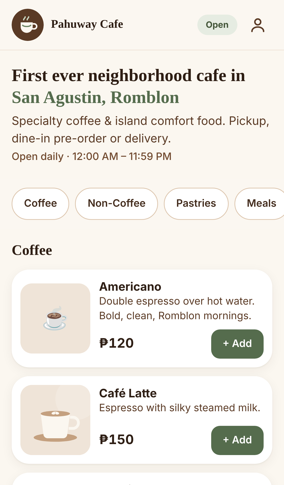
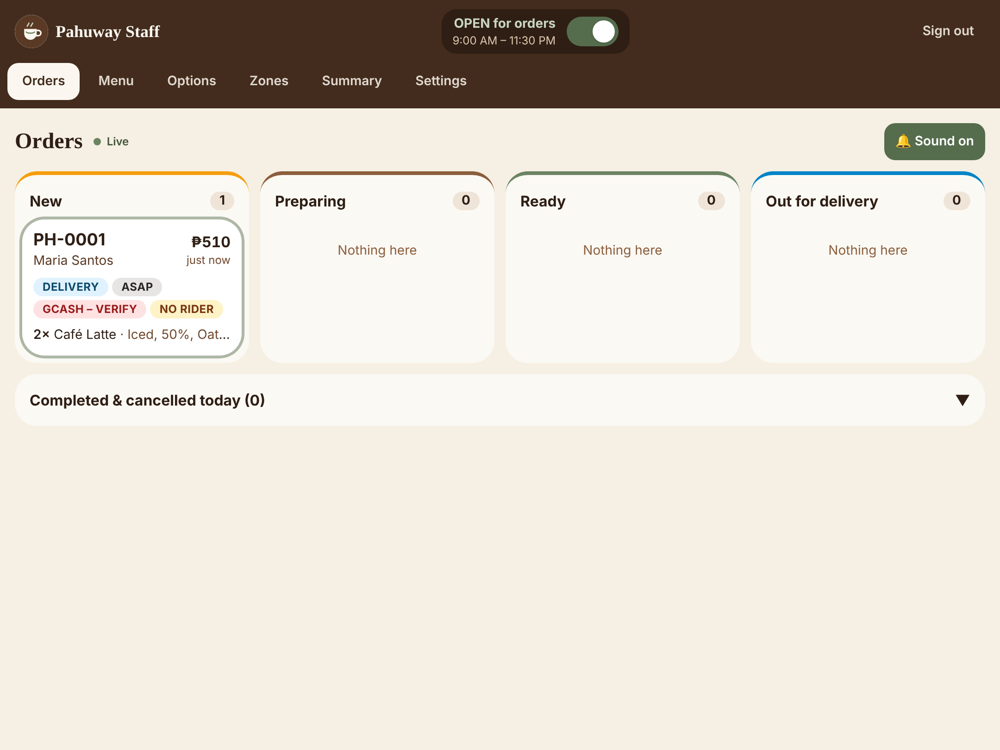
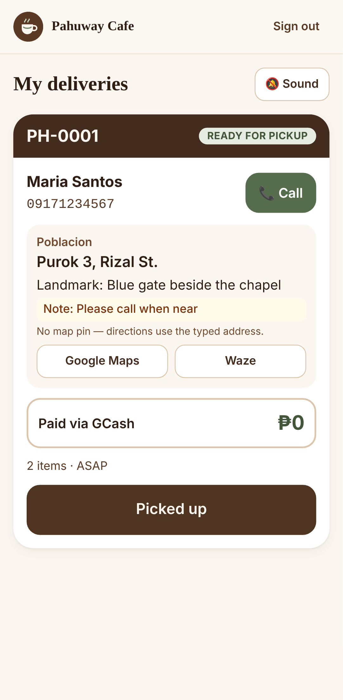

# Pahuway Cafe — online ordering & delivery

A lean, mobile-first ordering app for **Pahuway Cafe** (San Agustin, Romblon). Customers order for **pickup, dine-in pre-order or delivery** without an account. Staff run everything from a phone or tablet, and riders get a simple list of their deliveries.

| Customer (phone) | Staff (tablet) | Rider (phone) |
|---|---|---|
|  |  |  |

More screenshots are in [`docs/screenshots/`](docs/screenshots).

**Online payments:** GCash and QR Ph via HitPay, alongside cash and manual GCash — see [docs/PAYMENTS.md](docs/PAYMENTS.md).

**Mobile app:** the same app ships as **Isla** for Android and iPhone (Capacitor), with push notifications. See [docs/MOBILE.md](docs/MOBILE.md) for the store release steps.

---

## What's inside

**Customers** go from menu to order placed in 3 screens:
1. **Menu**: categories, photos, prices and "Sold out" badges. Tap an item to choose options (hot/iced, sugar level, milk, add-ons, pizza size) with live price updates. The cart opens as a drawer on the same screen.
2. **Checkout** (one page): pickup, delivery or dine-in; ASAP or a 15-minute time slot; name and mobile number. Delivery adds a barangay (the fee applies automatically), street/purok, landmark and notes to the rider. Payment is cash, or GCash (QR code + reference number + screenshot upload).
3. **Confirmation & live status**: order number (e.g. `PH-0001`), a live progress timeline, and a shareable link.

There's also an optional **account** (`/account`) that saves the customer's address and shows their order history.

**Staff** (`/admin`):
- **Orders board**: live columns (New → Preparing → Ready → Out for delivery) and a loud chime for new orders that repeats every 30 s until they're accepted. Staff can accept, or reject with a reason, assign a rider and verify GCash payments (the screenshot is shown).
- **Menu**: items, categories and photos, with a one-tap **Sold out** switch.
- **Options**: choice groups and extra prices (e.g. turn off "Oat milk" when it runs out).
- **Zones**: barangays, fees and on/off switches.
- **Settings**: **branding** (logo, background photo with fade, store name, staff header title, and customer/staff header colours with automatically readable text — updates live everywhere), open/closed switch (also in the header), hours, delivery minimum, prep time, GCash QR, and a **Riders** section to create rider logins.
- **Summary**: orders, sales, average order, top 5 items, and sales by order type and payment method, for any day.

**Riders** (`/rider`): only *their* assigned deliveries, with tap-to-call, address, landmark, a Maps link and the **amount to collect**, plus big **Picked up** and **Delivered** buttons.

## Why this stack

**Next.js + Tailwind + Supabase**, hosted free or cheaply on **Vercel + Supabase**:

- **No server to look after.** Supabase provides the database, logins, photo storage and live updates in one place. A small café shouldn't be patching servers.
- **The rules live in the database.** Orders are placed through one database function, `place_order`, which recomputes every price, checks the 09XXXXXXXXX number format, the minimum order, opening hours and sold-out items. Access rules in the database (row-level security, or RLS) make sure riders only see their own orders and guests only see the order behind their link. A modified browser can't get around any of this.
- **Realtime is built in.** The staff board, the rider list, sold-out badges and the open/closed state all update instantly over Supabase Realtime.
- **Cost:** Supabase and Vercel free tiers are enough for a single café's volume. Expect ~US$25/mo for Supabase Pro if you want daily backups and no project pausing; the free tier pauses after 7 days without activity.

---

## Setup (local development)

**Requirements:** Node 20+, plus Docker if you want a local Supabase stack. You can skip Docker and use a free hosted Supabase project (see Deploy) for development too.

```bash
npm install
```

```bash
npm run db:start
```

`db:start` starts local Supabase, applies `supabase/migrations/0001_schema.sql` and loads `supabase/seed.sql`. It prints an API URL and keys. Copy `.env.example` to `.env.local` and fill in:

| Variable | Where to find it | Used by |
|---|---|---|
| `NEXT_PUBLIC_SUPABASE_URL` | `API_URL` from `db:start`, or Supabase → Settings → API | browser + server |
| `NEXT_PUBLIC_SUPABASE_ANON_KEY` | `ANON_KEY`, or Settings → API → anon public | browser + server |
| `SUPABASE_SERVICE_ROLE_KEY` | `SERVICE_ROLE_KEY`, or Settings → API → service_role | **server only**: "Add rider" button + seed script. Never expose it. |
| `SEED_ADMIN_EMAIL` / `SEED_ADMIN_PASSWORD` / `SEED_RIDER_EMAIL` / `SEED_RIDER_PASSWORD` | your choice (optional) | `npm run seed:users` |
| `HITPAY_API_KEY`, `HITPAY_SALT`, `HITPAY_ENV`, `NEXT_PUBLIC_SITE_URL` | see [docs/PAYMENTS.md](docs/PAYMENTS.md) | **server only**: online payments (optional) |
| `PUSH_WEBHOOK_SECRET`, `FIREBASE_SERVICE_ACCOUNT`, `APNS_KEY_ID`, `APNS_TEAM_ID`, `APNS_PRIVATE_KEY`, `APNS_BUNDLE_ID` | see [docs/MOBILE.md](docs/MOBILE.md) | **server only**: push notifications for the Isla app (optional) |

Then create the starter logins and run the app:

```bash
npm run seed:users
```

```bash
npm run dev
```

Open http://localhost:3000. Staff and riders sign in at http://localhost:3000/login.

| Account | Email | Default password |
|---|---|---|
| Admin | `admin@pahuway.cafe` | `ChangeMe-Admin-2026` |
| Rider | `rider@pahuway.cafe` | `ChangeMe-Rider-2026` |

**Change these passwords before going live** (Supabase → Authentication → Users), or set the `SEED_*` variables before seeding.

### Seed data
- 20 menu items across Coffee, Non-Coffee, Pastries and Meals. Butter Croissant starts **sold out** so you can see the badge.
- 6 option groups: Temperature, Sugar level, Milk, Add-ons (max 3), Size (pizza solo/sharing), Meal add-ons.
- 5 delivery zones: Poblacion ₱30, Carmen ₱50, Dubduban ₱60, Long Beach ₱70, Cabolutan ₱80. **The fees are placeholders; set your real ones in Admin → Zones.**
- Store hours 9:00 AM – 11:30 PM (Asia/Manila), ₱200 delivery minimum, and a **SAMPLE** GCash QR. Upload the real one in Admin → Settings.
- Menu photos are bundled illustrations, so the app looks finished on day one. Replace them with real photos from Admin → Menu.

## Deploy (Vercel + Supabase)

1. **Create a Supabase project** at supabase.com and pick the **Southeast Asia (Singapore)** region, closest to Romblon.
2. **Create the database.** In the project's **SQL Editor**, run `supabase/migrations/0001_schema.sql`, then `supabase/seed.sql`. Or use the CLI: run `npx supabase link --project-ref <ref>`, then `npx supabase db push`, then run `seed.sql` in the SQL Editor.
3. **Auth settings** (Authentication → URL Configuration): set **Site URL** to your Vercel URL. Under Providers → Email, decide whether customer sign-ups need email confirmation (on by default; the app handles both).
4. **Create the logins.** Put the project's URL and service-role key in `.env.local`, then run `npm run seed:users` once from your computer.
5. **Deploy to Vercel.** Import the GitHub repo and add the three env vars (`NEXT_PUBLIC_SUPABASE_URL`, `NEXT_PUBLIC_SUPABASE_ANON_KEY`, `SUPABASE_SERVICE_ROLE_KEY`). The defaults handle the build.
6. **Check:** open the site on a phone and place a test order. Open `/admin` on the counter tablet and tap **"Tap to turn on order sound"** (browsers only allow sound after a tap, so do this once at the start of each shift). Turn the store **closed** and confirm customers see the closed message.

**Tips for the counter tablet:** keep it plugged in, turn off auto-lock (or use "Guided Access" on iPad), and add `/admin` to the home screen.

## Testing

| What | Command | Notes |
|---|---|---|
| Type check | `npm run typecheck` | |
| Production build | `npm run build` | |
| Database rules (66 checks) | `npm run test:db` | Needs `npm run db:start`. Checks prices, validation, sold-out, closed store, minimum order, RLS (guest / customer / rider / admin), role escalation, rider actions, realtime broadcasts and the summary. Resets the local DB afterwards. |
| Database rules without Docker | see `supabase/tests/supabase_stubs.sql` | Runs the same scenarios on plain Postgres with stand-ins for Supabase's schemas. |
| Push sender (Firebase + APNs mocked, 12 checks) | `npm run test:push` | Needs local Supabase + `seed:users`. |
| App-mode behaviour (13 checks) | `npm run test:native` | Runs the site with Capacitor's real Android bridge and a fake native side: push registration, Notify me, no-Firebase safety. Needs the app on :3000. |
| Online payments: routes (24 checks) | `npm run test:payments` | Payment requests, webhook HMAC (form + JSON), API re-confirmation, amounts, idempotency, return-check vs. a mock HitPay. |
| Online payments: browser flow (14 checks) | `npm run test:payments:e2e` | Pay online → board shows order only when paid → refund → resume abandoned checkout → confirm without webhook. See docs/PAYMENTS.md for the env to start the app with. |
| Branding (21 checks) | `npm run test:branding` | Logo, background, store name, staff title and header colours: live updates, measured text contrast, staff screens stay plain, reset to defaults. |
| End-to-end acceptance test | `npm run test:e2e` | Needs local Supabase + `seed:users` + the app on :3000, plus Playwright (`npm i -D playwright && npx playwright install chromium`). Drives a customer phone, staff tablet and rider phone at once and re-creates the screenshots. |

The end-to-end test covers every acceptance criterion: a guest orders a customised iced latte for delivery and pays by GCash screenshot. Staff see it instantly with a chime, verify payment, accept, assign the rider and mark it ready, and the customer's page updates live at each step. The rider sees only their order and marks it picked up, then delivered. Marking Americano sold out removes its Add button on the customer's phone at once. Closing the store blocks ordering with a friendly message.

## Project structure

```
supabase/
  migrations/0001_schema.sql   tables, RLS, order functions, triggers, storage, realtime
  seed.sql                     sample menu, options, zones, settings
  tests/                       database scenario tests (+ stubs for plain Postgres)
src/
  app/                         routes: / · /checkout · /order/[token] · /account · /login · /admin/* · /rider · /api/admin/riders
  components/customer/         menu, item sheet, cart, checkout, status page
  components/admin/            orders board, order detail, menu/options/zones/settings/summary
  lib/                         Supabase clients, cart, opening hours & time slots, formatting, sound
scripts/seed-users.mjs         creates the admin + rider logins
tests/e2e.js                   Playwright acceptance test
docs/                          SCHEMA.md, PHASE2.md, screenshots
```

## Operating notes & limits (MVP)

- **GCash is verified by hand.** Staff compare the reference number and amount in the café's GCash app, then tap *Mark GCash payment verified*. Screenshots are private (staff only).
- **Scheduling is same-day only,** in 15-minute slots from "now + prep time" up to 15 minutes before closing. Closing times after midnight are supported.
- **Language:** all customer text is in the components, ready to move into a translation file when Filipino labels are added (see Phase 2).
- **Phone validation** accepts `09XXXXXXXXX`, `+639…` or `639…` (spaces and dashes are fine) and stores everything as `09XXXXXXXXX`.
- **Cash orders** are marked paid automatically when completed or delivered.

Further reading: [Database schema](docs/SCHEMA.md) · [Phase 2 roadmap](docs/PHASE2.md)
