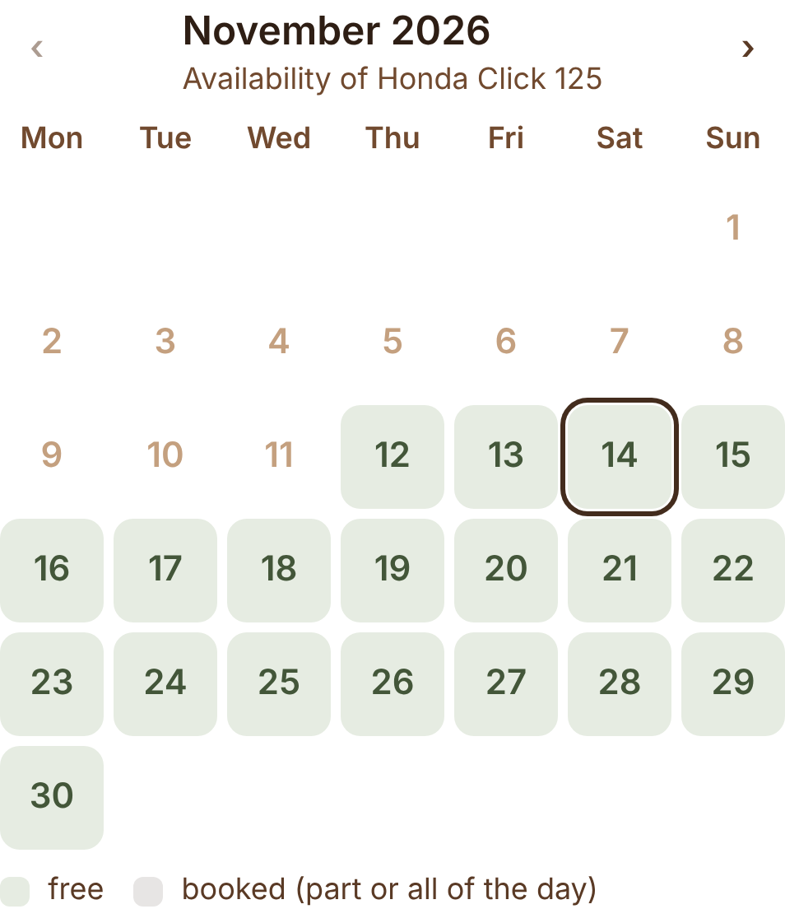
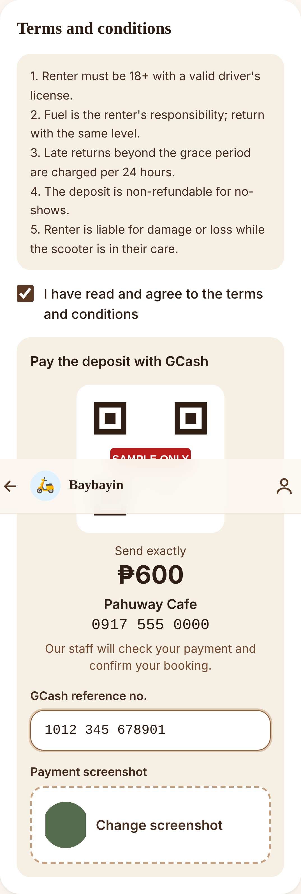
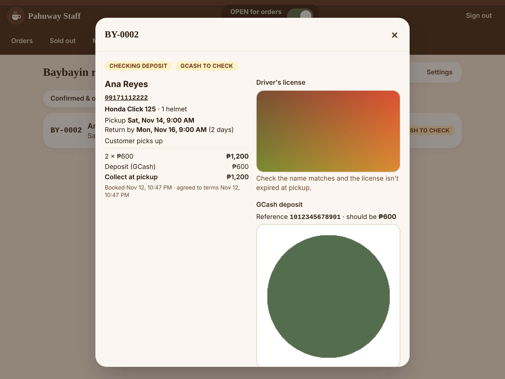

# Baybayin scooter rentals

Customers pick days on an **availability calendar**, choose a **pickup and return date and time** on the Baybayin page (`/baybayin`), charged **per 24 hours**, upload a photo of their driver's license, choose helmets, **agree to your terms and conditions**, then pay the deposit either **online through HitPay** (confirms instantly — when *Online deposit (HitPay)* is on) or **by GCash** to the café's GCash account with a receipt upload, which staff check — the same two choices as the café checkout. **All bookings are pickup** (no delivery). The rest is paid at pickup.

 

## How it works
1. **Calendar:** a month view shows which days are free. With no scooter chosen it shows how many scooters are free each day (green = all free, amber = some booked, grey = fully booked); once a scooter is chosen it shows that scooter's booked days. Tapping a day sets the pickup date. It shows no customer details.
2. **Times:** pickup and return time, **only within your pickup & return hours** (default **8:00 AM – 10:00 PM**, 30-minute steps; at least 1 hour). For an earlier or later time the customer ticks **"I need a pickup or return outside 8:00 AM – 10:00 PM"**: the booking form is replaced by a **Message us on Messenger** button (opens your Facebook page's Messenger with a ready message) and the café phone, so you can arrange it with them. The database also refuses bookings outside the hours. Days are counted in **24-hour blocks**: 9 AM → 9 AM next day = 1 day; a same-day rental = 1 day; returning later than the **grace period** (default 60 min) adds a day. Price = days × the scooter's daily rate. Scooters already booked during those times show as **Booked**.
3. They fill in name, mobile, optional email, helmets (0–2), the **license photo** and notes.
4. **Terms:** your terms and conditions are shown with an *I have read and agree* checkbox. The **payment options only appear after they tick it.** With the online deposit on they choose **Pay online** (default: HitPay page for GCash, Maya, QR Ph or online banking; the booking confirms automatically, the customer gets the confirmation text, and an unpaid online booking is released after **30 minutes** — their booking page offers **Pay now** until then) or **GCash (send manually)**. The GCash form It shows the café's GCash QR, name and number (from Admin → Settings → Payments), the exact **deposit** to send (your deposit % of the total), a field for the **GCash reference no.** and a **payment screenshot** upload.
5. They tap **Book & send ₱… deposit** and land on their booking page: **"We're checking your GCash payment"**. The scooter is held for them right away (no 30-minute expiry). The page updates by itself once staff confirm: **"You're booked! Deposit received ✓"**. That page is their booking link.
6. **No double-booking:** the database itself refuses overlapping bookings for the same scooter, even if two people book at the same moment — bookings waiting for GCash checking count too. Until it comes back, the scooter stays blocked up to its scheduled return plus the **time between bookings** (default 30 min). **As soon as staff tap *Mark returned*, it's open for booking again** — even if it came back early. If a scooter is **overdue** (picked up and past its return time), it stays **unavailable for every date** — on the booking page and calendar — until staff mark it returned.
7. Each booking keeps a **copy of the terms** the customer agreed to and when, so later edits to the terms don't change past bookings.

## Staff: Admin → Rentals
Visible to full admins and staff with the **Scooter rentals** permission (Settings → Team).
- **Bookings** — filters (Confirmed & on the road · **GCash to check (n)** · Returned & cancelled · All). Open a booking to see the customer (tap-to-call), times, helmets, notes, what to **collect at pickup**, the security deposit, the **license photo** and the **GCash reference + receipt screenshot** (both private — only rental staff can open them).
  - Waiting for GCash: compare the reference and amount with your GCash app, then **Deposit verified** (→ confirmed; the customer gets the confirmation text) or **Payment not received — cancel** (cancelled with that reason; the customer is texted).
  - Then **Mark picked up** → **Balance collected** → **Mark returned**, or **Cancel** with a reason.
  - A cancelled booking with a paid deposit shows **Refund needed**. Online deposits: **Refund ₱… deposit** sends it back through HitPay. GCash deposits: send it back by GCash, then tap **Mark deposit refunded**. Both need the Refunds permission; the customer is texted.
- **Calendar** — month grid with each day's bookings (amber = GCash to check, green = confirmed, blue = on the road, grey = returned). Tap a day to list its pickups and returns; tap a booking to open it.
- **Scooters** — add/edit name, short description, **daily rate**, photo, and *Show on the booking page*. Price changes only affect new bookings; hide a scooter instead of deleting it.
- **Settings** — **Pickup & return hours** (earliest / latest time) and the **Messenger link** for special arrangements (e.g. `https://m.me/YourPage`), **Online deposit (HitPay)** on/off (needs HitPay set up on the website; GCash with a receipt is always offered), **Terms and conditions** (paste your own; **bookings stay closed — *Coming soon* — until terms are saved**), **Accept bookings**, GCash deposit %, longest rental (days), late-return grace, time between bookings, security deposit at pickup (+ note), pickup instructions. Deposits go to the café's GCash set in Admin → Settings → Payments.

## Text messages (SMS via Semaphore)
Customers get a text when their **booking is confirmed** (after staff verify the GCash deposit), a **pickup reminder** a few hours before pickup (default 3 hours; not sent for bookings made less than 30 minutes earlier), and a text if the booking is **cancelled** or the **deposit refunded**. Staff numbers you list get a **new-booking alert** with the GCash reference to check. Each text is sent once (staff can **Resend** from the booking), and every booking shows its **text log**.

Texts use plain characters ("P805", not "₱805") because one special character makes a text Unicode — 70 instead of 160 characters per SMS part. Most texts are 1–2 parts (the confirmation includes the booking link).

**Setup**
1. In your Semaphore account (semaphore.co), copy the **API key** (Account → API). Buy credits — pricing is per SMS part; check Semaphore's current rates.
2. *(Optional)* Request a **sender name** (e.g. BAYBAYIN) in Semaphore; until it's approved, texts come from Semaphore's default sender.
3. Vercel → Settings → Environment Variables (Production): `SEMAPHORE_API_KEY` = your key, and optionally `SEMAPHORE_SENDER_NAME` = your approved name. **Redeploy**.
4. Admin → Rentals → Settings → *Text messages (SMS)*: it should say **Semaphore is connected**. Add staff alert number(s), set the reminder hours, then **Send test text** to your phone.

The pickup-reminder check runs in the database every 10 minutes and calls the website (`/api/rentals/reminders`, guarded by a private key stored in the database). It needs the website address in the database (`private.app_config` → `site_url`), set when this feature went live.

## Going live checklist
1. Add your scooters (with photos and daily rates).
2. Paste your **terms and conditions** in Rentals → Settings, check the pickup & return hours and add your page's **Messenger link**, then save.
3. Set the deposit %, security deposit and pickup instructions. Check the café's GCash QR/number in Settings → Payments.
4. Give the people who run rentals the **Scooter rentals** permission (Settings → Team).
5. Turn on **Accept bookings** and place one real test booking with a small deposit; verify it, then cancel and mark it refunded.

## Notes & limits
- License photos are stored privately; consider deleting old ones periodically (Supabase → Storage → license-photos).
- GCash receipts for rentals are stored privately under `payment-proofs/proofs/rentals/`.
- Online deposits arrive in the same HitPay account as café online orders (same keys).
- Not yet: email confirmations, damage/fuel charges — see docs/PHASE2.md ideas.

## For developers
- DB: `supabase/migrations/0011_scooter_rentals.sql` + `0012_rental_times.sql` — `rental_settings` (incl. `grace_minutes`, `turnaround_minutes`), `scooters`, `rental_bookings` (`pickup_at`, `return_at`, `blocked_until` = return + turnaround; exclusion constraint `no_double_booking` on `tstzrange(pickup_at, blocked_until)`), `rental_days()` (24-h blocks with grace), `busy_scooters(pickup, return)`, `book_scooter()` (server pricing + validation; v2 in `0014_rental_gcash_terms_calendar.sql`: requires terms agreed + GCash reference + receipt path, pickup only, `for_verification`, terms copy; `0018_rental_overdue_hold.sql` keeps overdue (picked up, past return) scooters unavailable for all dates in `busy_scooters`, `scooter_calendar` and `book_scooter`; `0017_rental_release_on_return.sql` shortens `blocked_until` to the return moment when a booking is marked returned; `0016_rental_hours_account_branding.sql` adds `open_time`/`close_time`/`messenger_url` and the hours check; `0015_rental_online_deposit.sql` adds `rental_settings.online_enabled` and `payment_method: online` → `awaiting_payment` with a 30-minute hold), `scooter_calendar(from, to)` (customer calendar, no personal data), `scooter_bookings_between()` (calendar, no personal data), `get_booking_by_token()`, `mark_booking_paid()` (service role), `expire_unpaid_bookings()` (pg_cron every 5 min + on each booking), private `license-photos` bucket, `rentals` permission. Scenarios: `supabase/tests/scenarios_rentals.sql`.
- API: `/api/rentals/new-booking` (staff "check the GCash" text, once), `/api/rentals/checkout`, `/verify`, `/refund` (HitPay online deposit), `/api/rentals/sms` (cancel/resend texts, status), `/api/rentals/sms-test`, `/api/rentals/reminders` (cron); SMS code in `src/lib/sms.ts` (Semaphore) and `src/lib/rental-sms.ts` (templates, once-only sending, log); DB `0013_rental_sms.sql` (settings, sent stamps, `rental_sms_log`, reminder tick); the shared `/api/payments/webhook` confirms deposits too (`confirmPayment` tries orders, then bookings).
- UI: `src/components/customer/{ScooterBooking,AvailabilityCalendar,BookingStatusScreen,BaybayinScreen}.tsx`, `src/components/admin/RentalsAdmin.tsx`, `src/lib/rentals.ts`.
- Test: `npm run test:rentals` (57 checks incl. online deposit on mock HitPay (pay, auto-confirm, refund, resume unpaid), terms gate, GCash receipt, calendars, verify/reject/refund, SMS via a Semaphore stand-in; start the app with the HitPay + Semaphore test env as in the test file).
